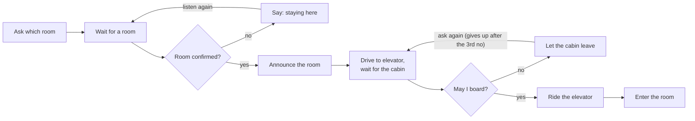

# Tiago Room Request Demo

`demo.py` makes Tiago ask which room of the IAI office it should drive to, confirm the
room by voice, and drive there. On the way it asks the people at the elevator whether it
may board. The run succeeds when Tiago ends on the room's floor.



Both questions loop: a refused room sends Tiago back to listening, and a refused ride
makes it wait for the next cabin. Tiago boards without asking when nobody is tracked at
the elevator.

## Prerequisites

The demo talks to the robot only through ROS 2, so the same interfaces must exist in
simulation and on the real Tiago. Only Giskard, the lidar and the elevator's joint states
are needed on a real run alone.

1. Use the project interpreter `~/envs/cram2/bin/python`.
2. Source ROS 2 and the workspace that provides `communication_skills`, `hri_msgs` and
   `hri_actions_msgs`.
3. Make sure every interface below is reachable on the same `ROS_DOMAIN_ID` as the demo.

| What | ROS interface | Type | Needed | On the real Tiago it comes from |
| --- | --- | --- | --- | --- |
| Speech output (`say` skill) | action `/skill/say` | `communication_skills/action/Say` | Always; missing for 10 s raises `SaySkillNotServedError` | PAL communication hub |
| Room requests | topic `/intents` | `hri_actions_msgs/msg/Intent` | Always | Chatbot or dialogue manager |
| Recognized speech (yes/no answers) | topic `/humans/voices/anonymous_speaker/speech` | `hri_msgs/msg/LiveSpeech` | Always | PAL speech recognition |
| People at the elevator | topic `/humans/persons/tracked` + TF frames `person_<id>` | `hri_msgs/msg/IdsList` | Optional; with nobody tracked Tiago boards without asking | ROS4HRI person manager |
| Motion control and world | action `giskard/command` + Giskard's world service | `json_msgs/action/JsonAction` | Real run only | Giskard on the robot |
| Base lidar | topic `scan` | `sensor_msgs/msg/LaserScan` | Real run only | Tiago base |
| Elevator cabin height | topic `/elevator/joint_states` | `sensor_msgs/msg/JointState` | Real run only | Elevator drive (or the ARISE Gazebo simulator) |

The office model is the IAI office (`IAIOffice`). On a real run it is merged into
Giskard's world, so it has to match the building the robot actually stands in.

## Running the demo

Running the module directly drives the real robot; pass
`KinematicallySimulatedPlanExecutor` to `main` to simulate it instead. The executor is
the only thing that changes between the two.

| Mode | Executor | World comes from | Elevator moved by |
| --- | --- | --- | --- |
| Real Tiago | `RealRobotPlanExecutor` (default of `main`) | Giskard, with the IAI office merged in | A person, read back from `/elevator/joint_states` |
| Kinematic simulation | `KinematicallySimulatedPlanExecutor` | Built locally, shown in RViz | `ElevatorOperator`, sent to the requested room's level |

### On the real Tiago

Check each part on its own before letting the robot drive. Only the last stage moves the
robot, and it asks you to type `DRIVE` first. Keep a person at the emergency stop.

```bash
PY=~/envs/cram2/bin/python
$PY -m experiments.tiago_room_request_demo.real_tiago_check preflight   # lists what is served/published, changes nothing
$PY -m experiments.tiago_room_request_demo.real_tiago_check say         # speaks through the skill, then through Giskard
$PY -m experiments.tiago_room_request_demo.real_tiago_check people      # prints the tracked people
$PY -m experiments.tiago_room_request_demo.real_tiago_check ask         # asks to board, prints the answer
$PY -m experiments.tiago_room_request_demo.real_tiago_check intent      # takes and confirms a room, does not drive
$PY -m experiments.tiago_room_request_demo.real_tiago_check drive       # the whole demo, after preflight and typing DRIVE
```

Options: `--sentence` (what `say` speaks), `--person-id` (whom `ask` asks; default the
first tracked person), `--intent-timeout` (seconds `intent` waits, default 120).

To skip the checks and run the demo directly:

```bash
~/envs/cram2/bin/python -m experiments.tiago_room_request_demo.demo
```

### In a kinematic simulation

```bash
~/envs/cram2/bin/python -c "from coraplex.plans.executors import KinematicallySimulatedPlanExecutor; from experiments.tiago_room_request_demo.demo import main; main(KinematicallySimulatedPlanExecutor)"
```

Tiago starts at x = -19 m, y = 39 m in the elevator room, with the elevator's doors open.
The simulation still needs a `/skill/say` server and someone publishing intents and
speech (next section). The repository ships no standalone `say` server; the test helpers
`SpeechListener` and `ScriptedPerson` in `test/experiments_test/tiago_elevator_demo_test/`
show a minimal one.

## Interacting with Tiago

On the real robot people simply speak; the chatbot and speech recognition turn that into
the messages below. Without them, publish the same messages by hand from a second
terminal.

### 1. Tell Tiago a room

Wait until Tiago has finished saying *Which room should I drive to?* Requests that arrive
while it is still speaking are ignored. Then send a move-to intent with the room's spoken
name as its `goal`:

```bash
ros2 topic pub --once -w 1 /intents hri_actions_msgs/msg/Intent \
  "{intent: '__intent_move_to__', data: '{\"goal\": \"room zero point four one\"}'}"
```

A raw user input works too, when its sentence contains the whole name of exactly one
room:

```bash
ros2 topic pub --once -w 1 /intents hri_actions_msgs/msg/Intent \
  "{intent: '__raw_user_input__', data: '{\"input\": \"please take me to room zero point four one\"}'}"
```

A move-to intent naming an unknown room makes Tiago say *I do not know the …* and keep
waiting. A sentence naming no room, or several, is ignored silently.

### Room names

A room is named by its number, spoken character by character: digits as words, `.` as
*point*, letters as letters. Matching ignores letter case.

| Number | Spoken name |
| --- | --- |
| 0.41 | room zero point four one |
| 0.41.1 | room zero point four one point one |
| 2.16g | room two point one six g |
| — | elevator room |

Only rooms a base fits into are listed; bathroom cabins are left out. To print every
name:

```bash
~/envs/cram2/bin/python -c "from semantic_digital_twin.predefined_maps.foyer_and_hallway_ground_floor.iai_office import IAIOffice; o = IAIOffice(); w = o.create_world(); print(*sorted(o.rooms_by_spoken_name(w)), sep='\n')"
```

### 2. Confirm the room

Tiago asks *Should I go to the room …?* Answer after it has finished the question;
earlier speech does not count:

```bash
ros2 topic pub --once -w 1 /humans/voices/anonymous_speaker/speech hri_msgs/msg/LiveSpeech "{final: 'yes'}"
```

- Agreeing words: yes, yeah, yep, sure, okay, ok.
- Refusing words: no, nope, not, don't, sorry. A refusing word wins over an agreeing one
  in the same sentence.
- No clear answer within 60 s counts as no.
- On a no, Tiago says *Okay, I will stay here.* and waits for the next request.

The speech carries no speaker, so anybody can answer.

### 3. Let Tiago board the elevator

After *I am heading to the room …* Tiago drives to the elevator and waits until the cabin
stands at its level. It then asks the tracked person nearest to it, inside the cabin or
in front of the doors, *May I take the elevator with you?* Answer with the same speech
message as above.

- Yes: Tiago boards, rides to the room's level and drives into the room.
- No: Tiago waits for the cabin to leave and come back, then asks again, at most 3 times.
- Nobody tracked at the elevator: Tiago boards without asking.

A person counts as tracked when their ID is on `/humans/persons/tracked` and TF has the
frame `person_<id>` relative to the world root.

## Configuration

Every setting is a field of `TiagoRoomRequestDemonstration`; construct it yourself
instead of calling `main` to change one:

```python
from coraplex.plans.executors import KinematicallySimulatedPlanExecutor
from experiments.tiago_room_request_demo.demo import TiagoRoomRequestDemonstration
from semantic_digital_twin.robots.tiago import Tiago

TiagoRoomRequestDemonstration(
    used_robot=Tiago,
    executor_type=KinematicallySimulatedPlanExecutor,
    room_request_timeout=60.0,
    maximum_boarding_attempts=5,
).run()
```

| Field | Default | Effect |
| --- | --- | --- |
| `executor_type` | `KinematicallySimulatedPlanExecutor` (`main` passes `RealRobotPlanExecutor`) | Real robot or simulation |
| `room_request_timeout` | 300.0 s | How long Tiago waits for each room request |
| `maximum_boarding_attempts` | 3 | Refusals at the elevator before Tiago gives up |
| `office` | `IAIOffice()` | The building and its rooms |
| `odom_T_robot_start` | x = -19 m, y = 39 m | Start pose of a simulated Tiago |
| `elevator_arrival_threshold` | 0.03 m | How far the cabin may stand from a floor and still serve it |
| `elevator_joint_state_topic` | `/elevator/joint_states` | Cabin height on a real run |
| `ros_node_name` | `tiago_room_request_demo_node` | Name of the demo's ROS node |

The speech timeouts (10 s for the `say` skill to be served, 60 s for an answer) are
fields of `YesNoQuestionAsker` and `RoomRequests`, not of the demonstration.

## Troubleshooting

Run `real_tiago_check preflight` first: it marks every missing action or topic as
`MISSING` and names the stages that need it.

| Symptom | Cause | Fix |
| --- | --- | --- |
| `SaySkillNotServedError` | `/skill/say` not served within 10 s | Start the communication hub on the demo's `ROS_DOMAIN_ID` (in simulation, a `say` server) |
| `NoRoomRequestedError` | No known room requested within `room_request_timeout` | Publish on `/intents` after the question ended; use the whole spoken name of one room |
| Tiago ignores a request | Sent while Tiago was still asking, or the sentence names no room or several | Resend after the question; check the name against the room list |
| Every answer counts as no | Speech sent before the question ended, no yes/no word in it, or the 60 s ran out | Answer after Tiago stops speaking, with a word from the lists above |
| `BoardingPermissionNotGrantedError` | Refused at the elevator `maximum_boarding_attempts` times | Answer yes, or raise the field |
| `ElevatorCabinTimedOutError` | The cabin did not arrive or leave within 600 s | Check that the elevator runs and `/elevator/joint_states` is published |
| Tiago boards without asking | Nobody tracked at the elevator, or TF lacks their `person_<id>` frame | Check with `real_tiago_check people` |
| `TargetRoomNotReachedError` | Tiago ended the plan on another floor than the room's | Check the elevator ride and that the office model matches the building |
